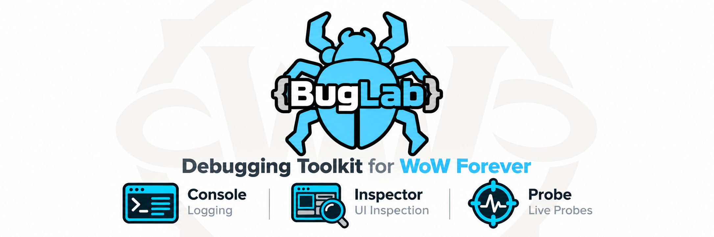

  

# README.md

  

BugLab ist ein modulares Debugging- und Analysewerkzeug für World-of-Warcraft-Addon-Entwickler (WoW Forever / Classic-Beta-Client).

## Module

| Modul | Aufgabe | Status |
|---|---|---|
| Console | Debug-Meldungen sammeln, filtern und darstellen | geplant |
| Inspector | UI-Frames, Eigenschaften, Hierarchien und Zustände untersuchen | geplant |
| Gallery | Texturen und Atlanten als Vorschau durchsuchen, Ausschnitt im Textur-Editor des Inspectors | in Arbeit |
| Probe | Von Addons angemeldete Tests (Probes) starten, Probe-Log | in Arbeit |
| Database | SavedVariables geladener Addons als Baum ansehen (nur lesend), suchen, als Lua-Text kopieren | in Arbeit |

## Installation

Den Ordner `BugLab` in `Interface/AddOns` des Spielclients kopieren.

## Bedienung

- `/buglab` oder `/bl` öffnet bzw. schließt das BugLab-Fenster (Reiter Console, Inspector, Gallery, Probe, Database; Reiter deaktivierter Module sind ausgeblendet).
- Minimap-Button: Linksklick öffnet das Fenster, Rechtsklick die Einstellungen, Ziehen verschiebt ihn. Ein Eintrag im Addon-Menü an der Minimap öffnet das Fenster ebenfalls.
- Strg+Umschalt+Alt+R lädt die Oberfläche neu (wie `/reload`); unter Allgemein abschaltbar.
- `/buglab help` bzw. `/buglab hilfe` listet alle Befehle.
- Die Einstellungen (Übersicht, Allgemein, Profile) liegen unter Spiel-Menü > Optionen > AddOns > {BugLab}.

## Lizenz

Alle Rechte vorbehalten, siehe `LICENSE`. Enthaltene Libraries (Ace3) stehen unter ihren eigenen Lizenzen.
